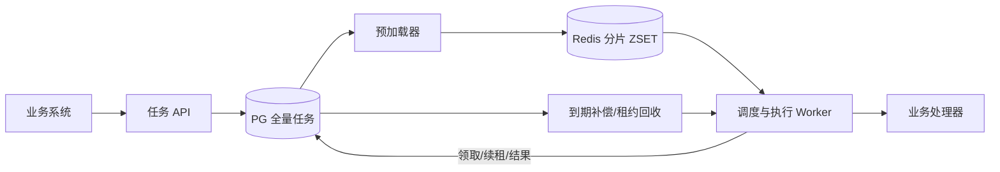

# 大容量延迟任务系统设计与开发交接

版本：v1.0（待容量评审）  
日期：2026-10-30  
状态：架构与实现协议已定义，可拆分开发；性能数字须经压测确认。

## 1. 决策摘要

采用 **PostgreSQL 全量持久化 + Redis ZSET 近期调度索引 + PG 原子领取 + Worker 租约执行 + PG 到期补偿**。

全部任务先写入 PG。远期任务仅驻留 PG，近期任务额外写入 Redis 索引；所谓“搬运”是复制索引，不是删除 PG 中的任务。Redis 可丢失、可重建，不能成为执行状态的唯一来源。

交付语义是至少一次执行，业务处理器必须支持幂等。不能承诺任意外部副作用恰好发生一次。成功创建后的持久性取决于 PG 的提交、复制和恢复配置。

首版支持一次性延迟任务；不包含 Cron、DAG、工作流编排和跨地域多活。

## 2. 待确认指标与初始配置

以下指标是上线评审输入，不阻塞协议和基础功能开发，但必须在性能验收前补齐。

| 指标 | 需业务/运维确认 |
| --- | --- |
| 存量任务 | 活跃任务数量、最大调度跨度、每日增量 |
| 峰值负载 | 创建 QPS、到期 QPS、整点突发数量与持续时间 |
| 延迟目标 | 正常及降级情况下，到期至开始执行的 P99 |
| 执行特征 | 平均/P99 耗时、最大执行时长、下游限流 |
| 数据可靠性 | PG 故障切换 RPO/RTO、备份恢复要求 |
| 数据保留 | 成功任务、死任务、幂等键保留期 |

初始配置仅用于开发和基准测试：

| 配置 | 初始值 | 说明 |
| --- | --- | --- |
| 近期窗口 | 10 分钟 | 同时设置索引数量/内存上限 |
| 逻辑分片 | 64 | 映射固定；扩容须迁移，不能直接修改取模数 |
| Redis 到期扫描 | 100～200ms | 空闲退避，繁忙时连续有界扫描 |
| 单批候选 | 200 | 不超过可用执行容量 |
| 预加载扫描 | 1 秒 | 批量 Pipeline 写入 |
| 缓存刷新间隔 | 60 秒 | 会产生额外 PG 写入，压测决定是否优化 |
| 到期补偿扫描 | 1～5 秒 | Redis 故障时承担降级调度 |
| 执行租约 | 60 秒 | 按任务类型调整 |
| 续租间隔 | 20 秒 | 必须小于租约长度，失败时停止新增业务动作 |
| 重试 | 指数退避 + 随机抖动 | 初始 1 秒，上限 5 分钟，次数按类型设置 |

## 3. 架构与部署



首版两个部署单元：任务 API、任务 Worker。Worker 内部划分预加载、调度、执行、补偿和回收模块，使用独立并发限制。暂不引入额外消息队列。

多实例使用分片租约减少重复扫描；即使分片归属短暂重叠，执行正确性仍由 PG 行状态与令牌决定。分片租约可用 PG 独立表实现，包含 shard_id、owner、lease_until，按数据库时间条件续租和接管。失去分片租约后停止新扫描；已有任务依照自身执行租约处理。

## 4. 数据模型

下表定义必需字段；类型可按仓库规范调整，不可删除版本和执行令牌的校验语义。

| 字段 | 建议类型 | 约定 |
| --- | --- | --- |
| task_id | UUID | 主键 |
| tenant_id | text | 租户隔离 |
| idempotency_key | text | 必填；同租户唯一 |
| request_hash | text | 同幂等键不同创建内容返回冲突 |
| task_type | text | 注册的处理器名称 |
| payload | jsonb | 小参数；设置大小上限 |
| payload_ref | text | 大参数引用，与 payload 二选一 |
| shard_id | integer | 创建时确定，后续不随改期变化 |
| next_run_at | timestamptz | 下一次允许执行时间 |
| status | text | scheduled/running/succeeded/dead/cancelled |
| schedule_version | bigint | 初始 1；改期、取消、重试重新排期时递增 |
| attempt | integer | 初始 0；成功领取时递增 |
| max_attempts | integer | 至少 1，包含首次尝试 |
| lease_token | UUID nullable | 每次领取产生新值 |
| lease_until | timestamptz nullable | 执行租约到期时间 |
| cache_refresh_at | timestamptz | 下次索引加载时间 |
| last_error | text nullable | 脱敏且截断 |
| created_at/updated_at | timestamptz | 数据库时间 |
| finished_at | timestamptz nullable | 终态时间 |

```sql
-- 到期扫描仅遍历待执行任务。
CREATE INDEX task_due_idx ON delay_task (shard_id, next_run_at, task_id)
WHERE status = 'scheduled';

-- 不重复扫描整个近期窗口。
CREATE INDEX task_refresh_idx ON delay_task (shard_id, cache_refresh_at, task_id)
WHERE status = 'scheduled';

-- 回收租约到期的任务。
CREATE INDEX task_lease_idx ON delay_task (lease_until, task_id)
WHERE status = 'running';

CREATE UNIQUE INDEX task_dedup_idx ON delay_task (tenant_id, idempotency_key);
```

增加状态枚举、attempt 非负、max_attempts 正数等约束。首版可先用普通表；哈希分区后必须重新设计主键和唯一约束，不可直接照搬上述唯一索引。PG 分区表的唯一约束需包含分区键，可采用独立去重表维护租户幂等键。

Redis 数据：

```text
key    = delay:{shard_id}
member = task_id:schedule_version
score  = next_run_at 的 Unix 毫秒时间
```

ZSET 不存 payload。清理时仅删除指定版本 member，不按 task_id 批量删除所有版本。

## 5. 状态机与并发协议

```text
scheduled --领取--> running --成功--> succeeded
scheduled --取消--> cancelled
scheduled --改期--> scheduled（版本递增）
running --可重试失败/租约超时--> scheduled（版本递增）
running --不可重试/次数用尽--> dead
dead --人工重试--> scheduled（版本递增，重置 attempt，记录审计）
```

取消、改期仅允许 scheduled。与领取并发时，以 PG 原子更新的获胜者为准；running 返回冲突，不能保证撤销已经发出的业务请求。

### 5.1 创建

1. 认证租户，校验处理器、参数大小、时间范围、配额和幂等键。
2. PG 事务写入 scheduled；cache_refresh_at = max(now, next_run_at - 窗口)。
3. 提交成功即可确认创建；近期任务尽力立即 ZADD，失败不回滚创建。
4. 相同幂等键和相同内容返回原任务；内容不同返回冲突。

若业务与任务在同库，允许调用方同事务写入。跨库必须在业务事务中写 Outbox，再幂等调用任务 API；不可依赖“业务提交后尽力请求 API”。

### 5.2 预加载

按分片和 cache_refresh_at 有界分页读取 scheduled，使用 Pipeline 写入 Redis。每个成功写入的条目，再通过 task_id、status、schedule_version 条件更新下次刷新时间。

必须先 ZADD 再更新刷新时间。失败条目不推进刷新时间；成功后崩溃只会重复写同一 member。若任务并发改期，旧写入最多留下无效索引，不得覆盖新版本刷新时间。

禁止跨 Redis 网络调用持有 PG 行锁。分页使用键集游标或刷新时间推进，避免 OFFSET 深分页。预加载覆盖所有已到刷新时间的任务，包括逾期任务。

### 5.3 领取

读取 score <= 当前时间的 Redis 候选；随后在 PG 中原子校验并领取。下面是单条协议示例，批量版本必须保留同样的条件：

```sql
-- PG 时间最终决定是否到期；Redis 仅提供候选。
UPDATE delay_task
SET status = 'running',
    attempt = attempt + 1,
    lease_token = $3,
    lease_until = clock_timestamp() + $4::interval,
    updated_at = clock_timestamp()
WHERE task_id = $1
  AND schedule_version = $2
  AND status = 'scheduled'
  AND next_run_at <= clock_timestamp()
  AND attempt < max_attempts
RETURNING *;
```

提交后删除对应 Redis member，再执行业务。若提交结果不确定，重新读取并确认当前 lease_token 仍属于本次领取且租约有效，才开始执行。

领取失败需区分：终态、已领取、版本过期可清理候选；PG 判断未到期则保留；PG 错误则保留重试。读取任务状态与删除旧 member 之间仍可能有并发变化，因此删除必须精确到版本。

只领取可立即执行的任务，不在进程内堆积已领取任务。执行发生在事务外。批量领取可用 FOR UPDATE SKIP LOCKED；锁仅覆盖短事务。

### 5.4 执行、续租与结果

处理器输入包括 task_id、稳定业务幂等键、attempt、payload、执行截止时间；输出成功、可重试错误或不可重试错误。

续租和结果更新必须同时匹配 task_id、running、lease_token，并校验 lease_until 尚未过期。影响行数为 0 表示失去所有权，旧 Worker 不得再提交状态。续租失败后停止新增副作用并尽力取消执行；已经发出的外部请求仍可能完成。

成功写 succeeded；失败在同一事务内决定 scheduled 或 dead。重新排期时递增 schedule_version，设置 next_run_at、cache_refresh_at，清除租约。成功提交后可尽力写入近期 Redis 索引。

## 6. 幂等与故障恢复

业务成功后、任务确认前崩溃会造成重复执行。lease_token 只能保护任务状态，无法阻止过期 Worker 的外部副作用。

- 同库业务：业务修改、业务幂等记录、任务完成可放进同一事务，事务中校验执行所有权。
- 外部服务：传递跨重试稳定的业务幂等键，接收方持久化去重。
- 不支持幂等的外部操作：必须提供结果查询/对账策略，不能盲目重试。

| 故障 | 恢复机制 |
| --- | --- |
| Redis 写入失败或全量丢失 | 预加载重建；到期补偿直接领取 |
| 预加载写 Redis 后崩溃 | 重复 ZADD，member 相同 |
| 领取成功后 Worker 崩溃 | 执行租约回收 |
| 外部调用成功但确认失败 | 重试，由业务幂等消除重复副作用 |
| PG 不可用 | 停止创建确认、领取、续租；恢复后补偿 |
| Redis 旧版本残留 | PG 校验后删除 |

到期补偿按 (shard_id, next_run_at, task_id) 索引扫描，使用同样的原子领取协议，可直接执行，不依赖 Redis。必须包含历史逾期任务，不能只扫描最近几分钟。

租约回收使用短事务锁定过期 running 记录，检查 attempt 后进入 scheduled 或 dead。回收与续租必须由 PG 锁和条件更新串行裁决。重排清除租约并递增版本，旧 Worker 的结果会被拒绝。

Redis 全量重建按分片限速；补偿优先保障已到期任务。失效索引需有后台有界清理，避免大量远期改期旧 member 长期占用内存。

## 7. API 合同

以下为 HTTP 语义示例，可映射成仓库现有 RPC 风格；租户身份从认证上下文获取。

| 接口 | 输入 | 结果/约束 |
| --- | --- | --- |
| POST /v1/tasks | idempotency_key、task_type、run_at、payload 或 payload_ref | task_id、status、schedule_version；提交 PG 后返回 |
| POST /v1/tasks/batch | 有界任务列表 | 逐项成功/失败；允许部分成功，重试依赖每项幂等键 |
| GET /v1/tasks/{id} | task_id | 状态、计划时间、尝试次数、脱敏错误 |
| POST /v1/tasks/{id}/cancel | expected_version | 仅 scheduled；递增版本；并发冲突返回 409 |
| POST /v1/tasks/{id}/reschedule | expected_version、run_at | 仅 scheduled；递增版本、更新刷新时间 |
| POST /v1/tasks/{id}/retry | expected_version、请求幂等键 | 仅 dead；重置次数、保留审计；需管理权限 |

统一时间格式 RFC3339，服务端存 timestamptz；过去的执行时间按立即可执行处理，超出允许范围返回参数错误。不存在或无权访问的任务对外采用一致响应，避免跨租户泄露。

错误类别：参数错误、认证失败、配额超限、版本/状态冲突、暂时不可用。对创建响应超时，客户端必须沿用原幂等键重试。

创建去重保留期必须明确：若任务记录提前归档/删除，应使用独立去重记录覆盖约定周期。

## 8. 容量、性能和保护

Redis 加速到期发现，不消除 PG 写入瓶颈。每个任务至少有创建、领取、完成三次写入，另有刷新、续租和重试；必须计入 WAL 和复制成本。

估算：近期索引数量约等于窗口内任务数，不等同于历史平均速率。若均匀到期速率为 10,000/s、窗口 600 秒，则约 600 万成员。若实测每个成员占 150～300 字节，则索引约 0.9～1.8GB，尚未包含碎片、副本和重建余量。这些数字是假设，不是测量结果。

1 亿任务若含索引平均每条 1KB，基础数据约 100GB，不含 WAL、备份、副本和膨胀。整点 100 万任务、下游吞吐 2 万/s，仅清理积压至少需要 50 秒。

实施要求：

- Redis 多分片 ZSET，避免单热 key；Pipeline 有界批量。
- PG 短事务、连接池上限、批量领取，监测索引和 autovacuum。
- Worker 按租户与类型控制并发/速率，满载停止领取。
- 正常与补偿扫描共用执行容量限制，避免降级时压垮 PG。
- 大 payload 与频繁更新的状态拆开，减少行更新成本。
- 已完成任务转移至历史存储，按完成时间分区清理；迁移和删除保持事务一致。
- 死任务不得被普通成功记录清理策略误删。
- 历史扫描和运维查询不得使用主执行路径的无限查询。
- 服务时钟同步；是否可执行以 PG 时间为准，不承诺硬实时。

先压测单 PG 实例，再决定哈希分区或多实例分片。分区不等于写吞吐横向扩容；跨实例扩容需增加路由、迁移和全局去重设计。

## 9. 监控与运维

必需指标：创建/领取/成功速率，到期至开始执行 P50/P95/P99，最老逾期时间，积压数，重试/死任务/租约过期数，预加载延迟，缓存重建进度，Redis 内存，PG 连接、锁等待、WAL、复制延迟、死元组。

日志关联 task_id、tenant_id、schedule_version、attempt、lease_token；payload 和错误中的敏感信息应脱敏。人工重试、取消、改期保留操作者与结果。

发布采用向后兼容迁移；滚动更新时停止领取、等待有界时间、对未完成任务依赖租约恢复。PG 同步复制、备份、PITR 和恢复演练必须与约定 RPO/RTO 一起验收。

## 10. 开发拆分与交付物

| 阶段 | 工作包 | 交付物与完成条件 |
| --- | --- | --- |
| 1 | 协议与存储 | 表结构/约束/索引迁移、状态机、幂等合同；并发条件评审通过 |
| 2 | API | 创建/批量/查询/取消/改期/重试；租户隔离和版本冲突验证 |
| 3 | PG 执行闭环 | 原子领取、处理器协议、续租、重试、租约回收；可不依赖 Redis 正常执行 |
| 4 | Redis 加速 | 预加载、版本索引、分片调度、旧索引清理；缓存删除后能重建 |
| 5 | 运维能力 | 限流、指标、审计、历史清理、部署与恢复手册 |
| 6 | 验收 | 压测、故障注入、容量报告；形成最终配置和性能承诺 |

开发交付包含：服务代码、数据库迁移、接口文档、处理器接入示例、配置说明、自动化测试、压测脚本、监控面板、部署/回滚/恢复手册。

优先完成 PG 闭环，再接 Redis，便于验证可靠性并保留可用的降级基线。工期需结合语言、现有组件和人员确认，本文件不预估未经评审的人天。

## 11. 验收清单

- [ ] 相同创建幂等键不会创建多个任务，不同内容冲突可识别。
- [ ] 同一任务并发领取只有一个有效所有者；任务不会早于 PG 计划时间开始。
- [ ] 取消/改期/领取并发符合状态机，旧版本索引无法执行。
- [ ] Redis 清空、重启、网络中断后，任务最终执行且能重建缓存。
- [ ] 预加载在写缓存前后被强杀，不丢任务。
- [ ] Worker 在领取后、业务完成后被强杀，均能恢复，业务幂等有效。
- [ ] 租约过期后的旧 Worker 无法续租或确认新一次执行结果。
- [ ] PG 响应丢失时，不因提交结果未知而直接执行无所有权的任务。
- [ ] 重试退避、次数用尽、人工重试及审计正确。
- [ ] 租户隔离、配额、payload 上限和错误脱敏有效。
- [ ] 均匀负载、整点突发、慢下游、Redis 降级分别满足已确认指标。
- [ ] 长稳测试覆盖表膨胀、归档清理、WAL 和内存，未出现持续失控增长。
- [ ] PG 故障切换和备份恢复满足约定 RPO/RTO。

容量报告必须记录硬件、PG/Redis 版本、存量数据规模、payload 分布、并发数、负载曲线、持续时间和观测结果，不得仅报告空库瞬时峰值。

## 12. 备选方案与参考

纯 PG 队列是低复杂度基线：若实测已满足吞吐和延迟，可暂缓 Redis 上线。若需求扩展到长流程、多步骤补偿、等待事件，应评估 Temporal，避免继续自建工作流引擎。

- [Redis Sorted Sets](https://redis.io/docs/latest/develop/data-types/sorted-sets/)：按分值查询；BZPOPMIN 等待元素存在，不会等待分值对应的时间。
- [PostgreSQL SELECT / SKIP LOCKED](https://www.postgresql.org/docs/current/sql-select.html)：适用于多消费者队列式访问，领取时应使用短事务。
- [Redis Persistence](https://redis.io/docs/latest/management/persistence/)：持久化选项不能代替本方案中的 PG 事实源。
- [Temporal](https://temporal.io/product)：持久化计时器与工作流平台。

## 13. 当前限制

本次交付为设计文档，尚未实现代码、检查项目现有组件的可复用性或进行性能测试。秒级精度、吞吐、恢复时长需在确认业务指标后验收；外部业务必须自行提供幂等或对账能力。
