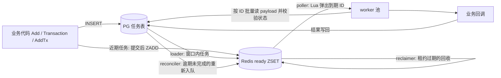

# 定时任务组件 scheduler 设计方案

版本：v0.2
日期：2026-11-14
状态：可开发，未开始编码；性能数字须经压测确认。

## 1. 决策摘要

- **形态**：Go 库 `pkg/scheduler`，嵌入业务进程，风格与 `pkg/compensator` 一致（自动建表、`Transaction` / `AddTx` 登记、进程内 worker 池执行回调）。不引入独立服务和消息队列。
- **存储分工**：PostgreSQL 保存全部任务，是唯一真相源。Redis ZSET 只保存近期窗口内任务的 ID 和到期时间，可丢失、可重建。
- **领取在 Redis 完成**：到期任务由 Lua 脚本原子弹出，PG 不参与抢占。远期任务每条 3 次 PG 写入，近期任务 2 次。
- **语义**：至少执行一次，回调必须幂等。不保证顺序。
- **精度**：到期至开始执行的延迟上限约为 `PollInterval`（默认 100ms）加一次 PG 批量读取。
- **Redis 不可用时**：登记照常成功，触发暂停，恢复后自动补齐，不丢任务。
- **易失任务**：经 `Add` 登记且延迟小于 10 秒的任务默认只进 Redis、完全不碰 PG（第 4.9 节），可按任务或按配置改变。Redis 丢数据时这类任务会丢。上面三条关于不丢任务的保证只针对持久任务。

与 `pkg/compensator` 的取舍：compensator 只依赖 PG，适合与业务事务绑定、量不大的补偿和延迟任务。scheduler 多依赖一个 Redis，换取更高的到期吞吐和更小的 PG 压力。

## 2. 架构



每个节点运行同一组后台循环，节点之间不选主：

| 循环 | 作用 | 多节点互斥方式 |
| --- | --- | --- |
| loader | 把进入窗口的任务从 PG 搬入 Redis | `FOR UPDATE SKIP LOCKED` |
| poller | 弹出到期任务交给 worker | Lua 原子弹出 |
| reclaimer | 回收租约过期的任务 | Lua 原子续期后处理 |
| reconciler | 把 PG 中已入队但 Redis 中缺失的任务补回 | Lua「不存在才写入」 |
| cleaner | 删除超过保留期的终态任务 | `FOR UPDATE SKIP LOCKED` |

## 3. 数据模型

### 3.1 PG 表

表名 `scheduler_tasks_<TableSuffix>`，启动时在 advisory lock 下自动创建并校验列，做法同 compensator。

```sql
CREATE TABLE scheduler_tasks_<suffix> (
  id           uuid PRIMARY KEY,          -- UUIDv7，按时间有序
  task_type    text NOT NULL,
  payload      text NOT NULL,             -- sonic 编码的 JSON 字符串
  status       smallint NOT NULL,
  run_at       timestamptz NOT NULL,      -- 下一次允许执行的时间
  attempts     integer NOT NULL DEFAULT 0,
  last_error   text NOT NULL DEFAULT '',
  created_at   timestamptz NOT NULL,
  updated_at   timestamptz NOT NULL,
  completed_at timestamptz
);

-- loader：只覆盖尚未入队的任务。
CREATE INDEX ..._load_idx   ON ... (run_at) WHERE status = 0;
-- reconciler：只覆盖已入队未完成的任务。
CREATE INDEX ..._queued_idx ON ... (run_at) WHERE status = 1;
-- cleaner：只覆盖终态任务。
CREATE INDEX ..._done_idx   ON ... (completed_at) WHERE status >= 2;
```

存储参数（fillfactor、autovacuum 阈值）沿用 compensator 的设置。

### 3.2 状态

| 值 | 名称 | 含义 |
| --- | --- | --- |
| 0 | pending | 只在 PG，尚未进入 Redis |
| 1 | queued | 已进入（或应当进入）Redis，包含执行中 |
| 2 | succeeded | 成功 |
| 3 | failed | 尝试次数耗尽 |
| 4 | cancelled | 已取消 |

PG 中没有 `running` 状态。执行中的事实由 Redis `processing` 集合表达，省去一次 PG 写入。

```text
pending --loader--> queued --成功--> succeeded
pending/queued --Cancel--> cancelled
queued --失败且有剩余次数--> queued（run_at 推后）
queued --次数耗尽--> failed --Retry--> pending
```

### 3.3 Redis

```text
ready       = {KeyPrefix}:{<suffix>:<bucket>}:ready        ZSET, score = run_at 的 Unix 毫秒
processing  = {KeyPrefix}:{<suffix>:<bucket>}:processing   ZSET, score = 租约到期的 Unix 毫秒
data        = {KeyPrefix}:{<suffix>:<bucket>}:data         HASH, 只存易失任务：id -> 任务内容
member      = 任务 ID 的 16 字节二进制
bucket      = hash(id) % Buckets
```

- 花括号是 hash tag，保证同一个桶的三个 key 在 Redis Cluster 中落在同一个 slot。
- ZSET 不存 payload。持久任务的 payload 在弹出后从 PG 批量读取；易失任务的内容在 `data` 中，弹出时一并返回。
- 持久任务和易失任务共用 `ready` / `processing`。区分方式：`data` 中有内容的是易失任务。
- `Buckets` 上线后不可直接修改。修改需要先停止登记并排空 Redis。

## 4. 核心流程

### 4.1 登记

| 入口 | 近期任务（`run_at < now + Window`） | 远期任务 |
| --- | --- | --- |
| `Add` / `Transaction` | 以 `queued` 写入 PG，提交后立即入队 Redis（`Add` 中延迟小于 `VolatileBelow` 的任务不走这里，见第 4.9 节） | 以 `pending` 写入 PG |
| `AddTx`（调用方提交） | 以 `pending` 写入 PG，由 loader 在 `LoadInterval` 内入队 | 同左 |

- `Add` / `Transaction` 提交后入队失败（Redis 故障或进程崩溃）不回滚、不报错，由 reconciler 在 `run_at + ReconcileGrace` 后补回。
- `AddTx` 不知道调用方何时提交，所以不直接写 Redis。短延迟任务走 `AddTx` 时，触发延迟最多增加一个 `LoadInterval`。
- 零值或过去的 `RunAt` 按立即执行处理。

不使用全局水位线判断「任务是否已被加载」：业务事务可能在 loader 扫过之后才提交，水位线会漏掉这些行。改用行上的 `status` 标记，任何 `pending` 且进入窗口的行都会在下一轮被 loader 取到。

### 4.2 loader

每 `LoadInterval` 执行，直到一轮取回的行数小于 `LoadBatch`：

```sql
UPDATE scheduler_tasks_<suffix> SET status = 1, updated_at = now()
WHERE id IN (
  SELECT id FROM scheduler_tasks_<suffix>
  WHERE status = 0 AND run_at < now() + $1::interval
  ORDER BY run_at LIMIT $2
  FOR UPDATE SKIP LOCKED)
RETURNING id, run_at;
```

语句提交后，把返回的行按桶分组，用 Pipeline 调用 `enqueue` 脚本写入 Redis。

先改 PG 再写 Redis。两步之间崩溃时任务处于 `queued` 但不在 Redis，由 reconciler 补回。

### 4.3 poller 与执行

每 `PollInterval` 执行一次，只弹出空闲 worker 数量的任务。一轮弹满则立即再弹，不等下一个间隔。

1. 对每个桶调用 `pop` 脚本，得到到期 ID、租约令牌和易失任务的内容。带内容的是易失任务，直接跳到第 5 步，不访问 PG。
2. 其余 ID 用一条语句从 PG 批量读取：`SELECT id, task_type, payload, attempts FROM ... WHERE id = ANY($1) AND status = 1`。
3. 查不到的 ID 说明任务已完成或已取消，调用 `ack` 从 `processing` 移除，不执行。
4. 读取失败（PG 暂时不可用）时调用 `requeue` 延迟 1 秒放回，不计尝试次数。
5. 其余任务交给 worker，回调在 `HandlerTimeout` 约束下执行。

第 2 步同时承担取 payload 和过滤失效成员两个职责。Redis 中任何原因产生的陈旧成员都在这里被拦下。

### 4.4 结果写回

先写 PG，再改 Redis。

| 结果 | PG | Redis |
| --- | --- | --- |
| 成功 | `status = 2, completed_at = now()`，条件 `status = 1` | `ack` |
| 失败，有剩余次数 | `attempts + 1`，`run_at` 按退避推后，记录 `last_error`，条件 `status = 1` | `requeue` 到新的 `run_at` |
| 失败，次数耗尽 | `status = 3, completed_at = now()` | `ack` |

- 三条 PG 语句都带条件 `status = 1`。影响行数为 0 说明任务已被取消或已由其他节点写回，此时不再改 PG，Redis 侧一律调用 `ack`。
- 退避为指数退避加随机抖动，范围 `RetryBackoffMin` ~ `RetryBackoffMax`。配置校验要求 `RetryBackoffMax <= Window`，重试任务始终留在 Redis，不退回 `pending`。
- PG 写入成功后 Redis 操作失败：成功的任务会在租约到期后被 reclaimer 发现并清除；失败的任务由 reclaimer 重新入队。
- `ack` / `requeue` 校验租约令牌。租约已被回收并由其他节点重新领取时，旧节点的 Redis 操作不生效。

### 4.5 reclaimer

每 `ReclaimInterval` 执行，处理 worker 崩溃或失联留下的任务：

1. `reclaim` 脚本取出 `processing` 中租约已过期的 ID，把它们的租约顺延一小段时间，返回新令牌和易失任务的内容。顺延是为了让多个节点不会同时处理同一批。带内容的易失任务按第 4.9 节处理，其余走下面两步。
2. PG：`UPDATE ... SET attempts = attempts + 1, status = CASE WHEN attempts + 1 >= $max THEN 3 ELSE 1 END ... WHERE id = ANY($1) AND status = 1 RETURNING id, status`。
3. 返回且仍为 `queued` 的 ID 调用 `requeue` 立即放回。其余（已是终态，或刚被置为 `failed`）调用 `ack` 移除。

租约过期计一次尝试，防止让进程崩溃的任务无限循环。

`LeaseDuration` 必须大于 `HandlerTimeout`，正常执行总能在租约到期前写回结果，v1 不做续租。

### 4.6 reconciler

每 `ReconcileInterval` 执行，按 `(run_at, id)` 游标分页扫描：

```sql
SELECT id, run_at FROM scheduler_tasks_<suffix>
WHERE status = 1 AND run_at < now() - $1::interval   -- ReconcileGrace
ORDER BY run_at, id LIMIT $2;
```

对每一批调用 `enqueue` 脚本。脚本只在成员既不在 `ready` 也不在 `processing` 时才写入，所以正常排队和执行中的任务不受影响。

它覆盖三种情况：loader 或 `Add` 在写 Redis 前崩溃、Redis 重启或主从切换丢数据、Redis 被整体清空。正常运行时这个查询的结果只包含执行中和积压的任务，数量很小。

### 4.7 取消与人工重试

- `Cancel(ctx, id)`：PG 中 `status IN (0, 1)` 的任务改为 `cancelled`，再尽力从 `ready` 中删除。任务不存在返回 `ErrNotFound`，已是终态返回 `ErrFinished`。已经开始执行的回调不会被中断，回调结束后状态保持 `cancelled`。
- `Retry(ctx, id)`：`failed` 的任务重置 `attempts`，`run_at` 设为当前时间，状态改回 `pending`，由 loader 重新入队。

### 4.8 清理

cleaner 每 `CleanupInterval` 分批删除 `completed_at < now() - Retention` 的终态任务。`failed` 使用单独的 `FailedRetention`，默认不删除。

### 4.9 易失任务（不进 PG）

用于量大、短期、丢了也无妨的任务。全程只用 Redis，PG 读写为零。

**如何启用**

- 按任务：`task.Volatile = true`。
- 按阈值：配置 `VolatileBelow`，默认 10 秒。经 `Add` 登记且延迟小于该值的任务自动成为易失任务，包括 `RunAt` 为零值或过去时间的立即执行任务。
- 配置为零值时取默认 10 秒，配置为负数时关闭阈值，只有显式 `Volatile = true` 的任务才是易失任务。
- 单个任务可用 `task.Durable = true` 排除在阈值之外。10 秒内但不能丢的任务必须设置这一项，或者经 `Transaction` / `AddTx` 登记。README 须在快速开始部分醒目说明这一默认行为。

**限制**

- 只能经 `Add` 登记。`Transaction` / `AddTx` 中的任务始终是持久任务，阈值对它们不生效；在事务中登记 `Volatile = true` 的任务返回 `ErrInvalidArgument`。易失任务不参与业务事务。
- 延迟不得超过 `Window`，payload 不得超过 `VolatileMaxPayload`。显式 `Volatile = true` 的任务不满足时返回 `ErrInvalidArgument`；只是被 `VolatileBelow` 阈值自动判定的任务不满足时回落为持久任务。
- Redis 写入失败时 `Add` 直接返回错误，没有兜底。
- `Get` 和 `Retry` 不支持易失任务，返回 `ErrNotFound`。

**流程**

| 步骤 | 做法 |
| --- | --- |
| 登记 | `enqueue_volatile` 脚本一次写入 `ready` 和 `data` |
| 执行 | `pop` 返回内容，直接执行 |
| 成功 | `ack`，同时删除 `data` 中的内容 |
| 失败，有剩余次数 | 内容中的 `attempts` 加一，`requeue` 时写回新内容 |
| 失败，次数耗尽 | `ack` 丢弃，上报指标并记录日志，不留记录 |
| 租约过期 | reclaimer 把 `attempts` 加一后 `requeue`，耗尽则 `ack` 丢弃 |
| 取消 | `Cancel` 在 PG 中找不到该 ID 时调用 `cancel_volatile`；已开始执行的不中断 |

`data` 中的内容是 sonic 编码的 JSON：`{"type": "...", "payload": "...", "attempts": 0}`。

**会丢的情况**：Redis 重启且未持久化、主从切换丢失未同步的写入、Redis 被清空、内存淘汰策略删除了 key。reconciler 不处理易失任务。部署时 Redis 的淘汰策略必须是 `noeviction`，否则持久任务的索引也会受影响。

## 5. Lua 脚本

所有脚本用 Redis 的 `TIME` 取当前时间，「是否到期」只由 Redis 时钟决定，不受各节点时钟偏差影响。

```lua
-- enqueue: KEYS = ready, processing; ARGV = score1, id1, score2, id2, ...
-- 成员在任一集合中已存在则跳过。返回实际写入的数量。
local n = 0
for i = 1, #ARGV, 2 do
  if not redis.call('ZSCORE', KEYS[1], ARGV[i + 1])
     and not redis.call('ZSCORE', KEYS[2], ARGV[i + 1]) then
    redis.call('ZADD', KEYS[1], ARGV[i], ARGV[i + 1])
    n = n + 1
  end
end
return n
```

```lua
-- pop: KEYS = ready, processing, data; ARGV = limit, lease_ms
-- 返回 {token, ids, datas, scores}。token 是租约到期时间，后续 ack / requeue 必须带回。
-- datas 与 ids 一一对应，持久任务对应位置为空。scores 是原到期时间，用于统计触发延迟。
local t = redis.call('TIME')
local now = t[1] * 1000 + math.floor(t[2] / 1000)
local res = redis.call('ZRANGEBYSCORE', KEYS[1], '-inf', now, 'WITHSCORES', 'LIMIT', 0, ARGV[1])
local token = now + tonumber(ARGV[2])
local ids, scores = {}, {}
for i = 1, #res, 2 do
  ids[#ids + 1] = res[i]
  scores[#scores + 1] = res[i + 1]
  redis.call('ZREM', KEYS[1], res[i])
  redis.call('ZADD', KEYS[2], token, res[i])
end
local datas = {}
if #ids > 0 then datas = redis.call('HMGET', KEYS[3], unpack(ids)) end
return {token, ids, datas, scores}
```

```lua
-- ack: KEYS = processing, data; ARGV = token, id
-- 令牌匹配才移除，并删除易失任务的内容。返回 1 表示已移除。
local s = redis.call('ZSCORE', KEYS[1], ARGV[2])
if s and tonumber(s) == tonumber(ARGV[1]) then
  redis.call('HDEL', KEYS[2], ARGV[2])
  return redis.call('ZREM', KEYS[1], ARGV[2])
end
return 0
```

```lua
-- requeue: KEYS = ready, processing, data; ARGV = token, id, delay_ms[, data]
-- 令牌匹配才从 processing 移回 ready，新的到期时间为 now + delay_ms。
-- 传入 data 时覆盖易失任务的内容（用于更新 attempts）。
local s = redis.call('ZSCORE', KEYS[2], ARGV[2])
if not s or tonumber(s) ~= tonumber(ARGV[1]) then return 0 end
local t = redis.call('TIME')
local now = t[1] * 1000 + math.floor(t[2] / 1000)
redis.call('ZREM', KEYS[2], ARGV[2])
redis.call('ZADD', KEYS[1], now + tonumber(ARGV[3]), ARGV[2])
if ARGV[4] then redis.call('HSET', KEYS[3], ARGV[2], ARGV[4]) end
return 1
```

```lua
-- reclaim: KEYS = processing, data; ARGV = limit, hold_ms
-- 取出租约过期的成员并顺延租约。返回 {token, ids, datas}，datas 含义同 pop。
local t = redis.call('TIME')
local now = t[1] * 1000 + math.floor(t[2] / 1000)
local ids = redis.call('ZRANGEBYSCORE', KEYS[1], '-inf', now, 'LIMIT', 0, ARGV[1])
local token = now + tonumber(ARGV[2])
for _, id in ipairs(ids) do
  redis.call('ZADD', KEYS[1], token, id)
end
local datas = {}
if #ids > 0 then datas = redis.call('HMGET', KEYS[2], unpack(ids)) end
return {token, ids, datas}
```

```lua
-- enqueue_volatile: KEYS = ready, data; ARGV = delay_ms, id, data
-- 到期时间用 Redis 时钟加延迟算出，不受应用节点时钟影响。
local t = redis.call('TIME')
local now = t[1] * 1000 + math.floor(t[2] / 1000)
redis.call('HSET', KEYS[2], ARGV[2], ARGV[3])
redis.call('ZADD', KEYS[1], now + tonumber(ARGV[1]), ARGV[2])
return 1
```

```lua
-- cancel_volatile: KEYS = ready, data; ARGV = id
-- 返回 1 表示在执行前取消成功，0 表示不存在或已开始执行。
redis.call('HDEL', KEYS[2], ARGV[1])
return redis.call('ZREM', KEYS[1], ARGV[1])
```

`ack` 和 `requeue` 在实现时提供批量版本（一次调用处理同一个桶、同一个令牌的多个 ID）。`pop` 和 `reclaim` 的 `limit` 不得超过 1000，避免 `unpack` 参数过多。

## 6. 对外 API

```go
s, err := scheduler.New(ctx, db, rdb, scheduler.Config{TableSuffix: "orders"},
    map[string]scheduler.Handler{
        "order.timeout": func(ctx context.Context, task *scheduler.Task) error {
            var p OrderTimeout
            if err := task.Decode(&p); err != nil {
                return err
            }
            return closeOrder(ctx, task.ID, p) // 以 task.ID 作为下游幂等键
        },
    })
defer s.Close()

task, _ := scheduler.NewTask("order.timeout", OrderTimeout{OrderID: 42})
task.RunAt = time.Now().Add(30 * time.Minute)

id, err := s.Add(ctx, task)                         // 独立登记
err = s.Transaction(ctx, func(tx *scheduler.Tx) error { // 与业务同事务
    _, err := tx.Add(ctx, task)
    return err
})
id, err = s.AddTx(ctx, sqlTx, task)                 // 接入已有事务

ping, _ := scheduler.NewTask("room.heartbeat", Heartbeat{RoomID: 7})
ping.RunAt = time.Now().Add(3 * time.Second)
ping.Volatile = true                                // 只进 Redis，可丢
id, err = s.Add(ctx, ping)

rec, err := s.Get(ctx, id)
err = s.Cancel(ctx, id)
err = s.Retry(ctx, id)
err = s.Register("order.refund", handleRefund)      // 运行期注册
```

- `db` 为 `*sqlx.DB`（pgx，PostgreSQL 14+），`rdb` 为 `redis.UniversalClient`（Redis 6.2+，单机和 Cluster 均可）。
- 错误：`ErrInvalidConfig`、`ErrInvalidArgument`、`ErrNoHandler`、`ErrNotFound`、`ErrFinished`、`ErrClosed`。
- `Close` 停止各循环，等待执行中的回调至多 `ShutdownTimeout`，等待期间不取消回调的 context。超时后才取消，被中断的任务立即放回且不计尝试次数；忽略取消的回调靠租约回收。

## 7. 配置

| 字段 | 默认值 | 说明 |
| --- | --- | --- |
| `TableSuffix` | 必填 | `[a-z0-9_]{1,40}`，决定表名和 Redis key |
| `Schema` | `current_schema()` | 必须已存在 |
| `KeyPrefix` | `sched` | Redis key 前缀 |
| `Buckets` | 8 | Redis 分桶数，上线后不可直接修改 |
| `Window` | 5m | 近期窗口，决定 Redis 中的任务数量 |
| `LoadInterval` | 1s | loader 扫描间隔 |
| `LoadBatch` | 1000 | loader 单批行数 |
| `PollInterval` | 100ms | 到期扫描间隔，决定触发精度 |
| `WorkerCount` | 16 | 每个节点同时执行的回调数 |
| `HandlerTimeout` | 30s | 单次回调超时 |
| `LeaseDuration` | 60s | 执行租约，必须大于 `HandlerTimeout` |
| `MaxAttempts` | 10 | 最大尝试次数，含首次 |
| `RetryBackoffMin` / `Max` | 1s / 5m | 重试退避范围，`Max <= Window` |
| `ReclaimInterval` | 5s | 租约回收间隔 |
| `ReconcileInterval` | 5s | 对账间隔 |
| `ReconcileGrace` | 10s | 任务逾期多久后才参与对账 |
| `VolatileBelow` | 10s | 经 `Add` 登记且延迟小于该值的任务自动成为易失任务；负数表示关闭 |
| `VolatileMaxPayload` | 4KB | 易失任务 payload 上限 |
| `Retention` | 24h | `succeeded` / `cancelled` 保留时长 |
| `FailedRetention` | 0（不删除） | `failed` 保留时长 |
| `CleanupInterval` | 1m | 清理间隔 |
| `ShutdownTimeout` | 30s | `Close` 等待回调的上限 |

## 8. 故障与一致性

| 故障 | 结果 | 恢复 |
| --- | --- | --- |
| Redis 不可用 | 登记成功，触发暂停 | Redis 恢复后 reconciler 补齐，逾期任务立即执行 |
| Redis 丢失部分或全部数据 | 持久任务延迟；易失任务丢失 | 持久任务由 reconciler 在 `run_at + ReconcileGrace` 后补回；易失任务不恢复 |
| PG 不可用 | 登记失败；已弹出的任务放回 Redis | PG 恢复后继续 |
| loader 在写 Redis 前崩溃 | 该批任务延迟 | reconciler 补回 |
| worker 在执行中崩溃 | 任务停在 `processing` | 租约到期后 reclaimer 回收，计一次尝试 |
| 回调成功但写回 PG 失败 | 任务重复执行一次 | 依赖回调幂等 |
| 任务被取消或完成后 Redis 仍有成员 | 不会执行 | 弹出时 PG 状态校验拦截 |

会产生重复执行的情况：回调成功后写回失败；回调实际耗时超过租约；Redis 丢失 `processing` 数据后对账重新入队。三种情况都属于至少一次语义，需要回调幂等。

## 9. 容量与性能

每个任务的开销：

| 路径 | PG 写 | PG 读 | Redis |
| --- | --- | --- | --- |
| 近期任务（`Add` / `Transaction`） | 2（登记、结果） | 1（批量） | 入队、弹出、确认 |
| 远期任务或 `AddTx` | 3（登记、入队标记、结果） | 1（批量） | 入队、弹出、确认 |
| 易失任务 | 0 | 0 | 入队、弹出、确认 |

入队标记和弹出后的读取都是批量语句。持久任务的瓶颈在 PG 的登记和结果写入；易失任务的瓶颈在 Redis 和回调本身。

Redis 内存只与窗口内的任务数有关，与任务总量无关。易失任务另外占用 payload 的空间。例如到期速率 5,000/s、窗口 5 分钟，Redis 中约 150 万个成员。单个成员的实际占用需要实测，本文不给出未测量的数字。

吞吐和延迟目标在阶段 5 压测后写入 README。压测报告须记录硬件、PG / Redis 版本、存量规模、payload 大小、节点数和负载曲线。

可选优化（压测显示结果写入是瓶颈时再做）：成功结果攒批写回，按 5ms 或 200 条合并为一条 `UPDATE`。代价是进程崩溃时这一批会重复执行。

## 10. 约束与 v1 不做的事

- 所有节点必须注册相同的回调集合。弹出到未注册类型的任务时延迟 1 秒放回并上报指标，不计尝试次数。
- 不保证任务之间的执行顺序。
- v1 不做：周期任务（cron）、改期（先 `Cancel` 再重新登记）、租约续期、Redis 不可用时由 PG 直接调度的降级路径、表分区、多租户与配额。
- 周期任务的后续做法：回调成功后在同一事务内登记下一次执行。

## 11. 指标

沿用 compensator 的 OpenTelemetry 做法：

- 计数：登记、入队、弹出、成功、失败、重试、取消、租约回收、对账补回、失效成员丢弃、未注册类型放回。
- 直方图：触发延迟（开始执行时间减 `run_at`）、回调耗时。
- 仪表：`ready` 中已到期未弹出的数量、`processing` 数量、PG 中 `pending` / `queued` 数量、最老逾期时长。

## 12. 开发拆分

| 阶段 | 内容 | 完成条件 |
| --- | --- | --- |
| 1 | `types.go`、`schema.go`、`storage.go`：配置校验、建表、PG 读写语句 | 单元测试和 PG 集成测试通过 |
| 2 | `queue.go`：七个 Lua 脚本和 Go 封装，分桶 | Redis 集成测试覆盖令牌校验、重复入队、单机与 Cluster |
| 3 | `scheduler.go`、`loader.go`、`worker.go`：登记、loader、poller、执行、结果写回、`Cancel` / `Retry` / `Get` | 端到端：近期、远期、`AddTx` 三条路径的任务按时执行 |
| 4 | `reclaimer.go`、`reconciler.go`、`cleaner.go`、`metrics.go` | 第 13 节的故障用例通过 |
| 4b | 易失任务：登记、执行、重试、回收、取消 | 第 13 节易失任务用例通过，执行全程无 PG 语句 |
| 5 | 压测脚本、`README.md` | 压测报告，README 写入实测的吞吐和延迟 |

每个阶段独立提交，测试随代码一起交付。

## 13. 验收清单

- [ ] 近期任务经 `Add` 登记后，触发延迟不超过 `PollInterval` 加一次批量读取。
- [ ] 远期任务在进入窗口后入队并按时执行；`AddTx` 登记的短延迟任务在 `LoadInterval + PollInterval` 内执行。
- [ ] 事务回滚后任务不存在，也不会出现在 Redis。
- [ ] 多节点并发时，同一任务在租约有效期内只被一个节点执行。
- [ ] 失败按退避重试，次数耗尽后为 `failed`，`Retry` 后重新执行。
- [ ] `Cancel` 后未开始的任务不执行；Redis 中残留的成员在弹出时被丢弃。
- [ ] 清空 Redis 后，所有未完成任务在 `ReconcileGrace + ReconcileInterval` 内恢复，无丢失。
- [ ] Redis 停机期间登记成功，恢复后逾期任务全部执行。
- [ ] loader 在改 PG 后、写 Redis 前被强杀，任务最终执行。
- [ ] worker 在回调执行中被强杀，任务在租约到期后由其他节点执行，`attempts` 加一。
- [ ] 租约被回收后，旧节点的 `ack` / `requeue` 不生效。
- [ ] 弹出后 PG 读取失败，任务放回且不计尝试次数。
- [ ] 终态任务按保留期清理，`failed` 默认不删除。
- [ ] 易失任务从登记到完成不产生任何 PG 语句，成功、丢弃、取消后 `data` 中无残留。
- [ ] 易失任务失败按退避重试，次数耗尽后丢弃并上报指标；worker 被强杀后由 reclaimer 回收且 `attempts` 加一。
- [ ] `VolatileBelow` 只对 `Add` 生效；事务中登记易失任务返回 `ErrInvalidArgument`；`Durable = true` 的任务不受阈值影响。
- [ ] 同一个桶内持久任务和易失任务混合时，各自走各自的路径，互不影响。
- [ ] 长稳压测中 Redis 内存和 PG 表大小不持续增长。

## 14. 实现须知

写给接手开发的人。本文没有写明的细节按本节处理。

### 14.1 先读的代码

- `pkg/compensator`：本组件的风格基准。配置解析与校验（`types.go`）、advisory lock 下建表和列校验（`schema.go`）、存储层组织（`storage.go`）、worker 池和优雅关闭（`worker.go`）、指标（`metrics.go`）、README 结构都照它写。
- `pkg/sqlxhelper`：事务封装。
- 不新增第三方依赖。`go-redis/v9`、`sqlx`、`pgx/v5`、`sonic`、`google/uuid`、OpenTelemetry 都已在 `go.mod` 中。

### 14.2 固定的实现决定

- 包路径 `pkg/scheduler`，文件划分见第 12 节。
- 任务 ID 用 `uuid.NewV7()`。Redis 成员是 ID 的 16 字节原始值，不是字符串形式。
- 分桶：`bucket = fnv1a32(id 的 16 字节) % Buckets`。
- Lua 脚本用 `redis.NewScript` 封装，由它处理 `EVALSHA` 未命中后回退 `EVAL`。
- 所有 PG 时间用数据库的 `now()`，不用应用时钟。唯一例外是登记时判断「是否近期任务」用本机时钟，判断错误只影响走哪条路径，不影响正确性。
- 登记时未注册的任务类型返回 `ErrNoHandler`。
- poller 每轮把空闲 worker 数作为总配额，从一个轮转的起始桶开始依次弹出，配额用完即停，避免靠前的桶长期优先。
- `reclaim` 的顺延时长固定 10 秒，单批上限 500。reconciler 单批上限 1000。
- 每个后台循环出错后记录日志并等下一个间隔，不退出循环。间隔加 10% 随机抖动，避免多节点同步。
- `Close` 时已弹出但尚未开始执行的任务调用 `requeue` 立即放回。

### 14.3 结果写回的语句

```sql
-- 成功
UPDATE scheduler_tasks_<suffix>
SET status = 2, completed_at = now(), updated_at = now()
WHERE id = $1 AND status = 1;

-- 失败：$2 = 退避时长，$3 = 截断后的错误文本，$4 = MaxAttempts
UPDATE scheduler_tasks_<suffix>
SET attempts = attempts + 1,
    last_error = $3,
    updated_at = now(),
    status = CASE WHEN attempts + 1 >= $4 THEN 3 ELSE 1 END,
    run_at = CASE WHEN attempts + 1 >= $4 THEN run_at ELSE now() + $2::interval END,
    completed_at = CASE WHEN attempts + 1 >= $4 THEN now() END
WHERE id = $1 AND status = 1
RETURNING status;
```

失败语句返回 `status = 1` 时调用 `requeue`，延迟为同一个退避时长；返回 3 或没有返回行时调用 `ack`。`last_error` 截断到 1024 字节。

### 14.4 测试要求

- 单元测试不依赖外部服务。集成测试的启用方式和环境变量与 `pkg/compensator/integration_test.go` 相同，Redis 的连接方式参照 `pkg/infra` 中的 Redis 集成测试。
- 第 13 节每一项对应至少一个自动化测试。涉及强杀的用例用「在指定步骤之间注入返回」的测试钩子实现，不真的杀进程。
- 测试中的时间间隔全部通过配置缩短，不使用长时间 `sleep`。

### 14.5 已采用的范围决定

- Redis 不可用时触发暂停，恢复后补齐，不做 PG 降级调度。
- v1 不做周期任务和改期。
- 默认值按第 7 节。
- `VolatileBelow` 默认 10 秒：经 `Add` 登记的 10 秒内任务默认不进 PG。
